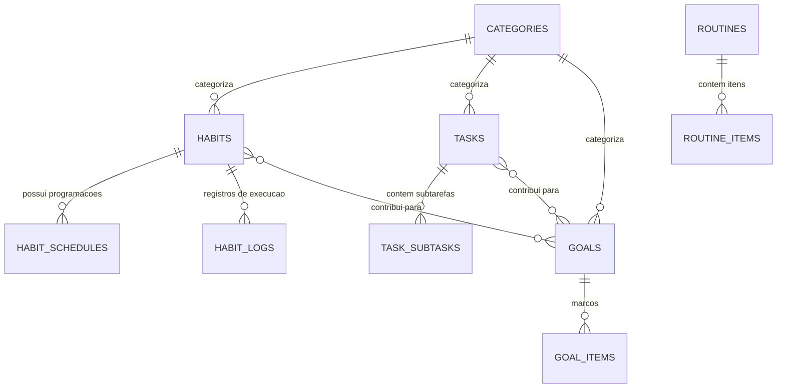

# LifeOS — Modelagem do Banco de Dados

**Banco:** SQLite 3  
**ORM:** SQLAlchemy 2.0  
**Migrações:** Alembic  

---

## 1. Diagrama de Relacionamento de Entidades (ERD)

---

## 2. Dicionário de Dados

### 2.1 `categories`
| Coluna | Tipo | Descrição |
|---|---|---|
| `id` | VARCHAR(36) PK | UUID v4 |
| `name` | VARCHAR(100) NOT NULL | Nome da categoria (ex: Saúde, Estudos, Trabalho) |
| `color` | VARCHAR(20) NOT NULL | Cor em hexadecimal (ex: `#10B981`) |
| `icon` | VARCHAR(50) NOT NULL | Nome do ícone Lucide |
| `created_at` | DATETIME | Data/hora de criação (UTC) |
| `updated_at` | DATETIME | Data/hora de atualização (UTC) |

### 2.2 `habits`
| Coluna | Tipo | Descrição |
|---|---|---|
| `id` | VARCHAR(36) PK | UUID v4 |
| `category_id` | VARCHAR(36) FK | Categoria associada |
| `name` | VARCHAR(150) NOT NULL | Nome do hábito (ex: Beber Água) |
| `description` | TEXT | Detalhes adicionais |
| `icon` | VARCHAR(50) | Nome do ícone |
| `color` | VARCHAR(20) | Cor do hábito |
| `habit_type` | VARCHAR(30) NOT NULL | `BOOLEAN`, `NUMERIC`, `DURATION` |
| `target_value` | FLOAT | Meta numérica (ex: 2000 ml, 60 min) |
| `unit` | VARCHAR(30) | Unidade de medida (ml, páginas, min, vezes) |
| `status` | VARCHAR(20) NOT NULL | `ACTIVE`, `PAUSED`, `ARCHIVED` |
| `start_date` | DATE NOT NULL | Início do acompanhamento |
| `end_date` | DATE | Fim do acompanhamento (opcional) |
| `created_at` | DATETIME | Data/hora de criação |
| `updated_at` | DATETIME | Data/hora de atualização |

### 2.3 `habit_schedules`
| Coluna | Tipo | Descrição |
|---|---|---|
| `id` | VARCHAR(36) PK | UUID v4 |
| `habit_id` | VARCHAR(36) FK | Hábito associado |
| `frequency_type` | VARCHAR(30) NOT NULL | `DAILY`, `WEEKLY_DAYS`, `INTERVAL`, `MONTHLY_DAYS` |
| `interval_value` | INT | Intervalo em dias (para `INTERVAL`) |
| `weekdays` | VARCHAR(50) | Dias da semana (ex: `0,2,4` para Seg, Qua, Sex) |
| `times_per_period` | INT | Número de vezes por semana/mês |
| `effective_from` | DATE NOT NULL | Início de vigência da regra de frequência |
| `effective_until` | DATE | Fim de vigência da regra de frequência (para versionamento) |
| `created_at` | DATETIME | Data de criação da regra |

### 2.4 `habit_logs`
| Coluna | Tipo | Descrição |
|---|---|---|
| `id` | VARCHAR(36) PK | UUID v4 |
| `habit_id` | VARCHAR(36) FK | Hábito associado |
| `scheduled_date` | DATE NOT NULL | Data de referência do hábito (AAAA-MM-DD local) |
| `completed_at` | DATETIME | Timestamp da conclusão |
| `value` | FLOAT NOT NULL DEFAULT 1 | Valor registrado (ex: 500 para ml, 1 para booleano) |
| `duration_seconds` | INT | Tempo dedicado em segundos |
| `status` | VARCHAR(20) NOT NULL | `COMPLETED`, `SKIPPED`, `FAILED` |
| `notes` | TEXT | Anotações do dia |
| `created_at` | DATETIME | Criação do registro |
| `updated_at` | DATETIME | Edição do registro |

### 2.5 `tasks` & `task_subtasks`
| Tabela | Colunas Principais |
|---|---|
| `tasks` | `id`, `category_id`, `title`, `description`, `priority` (LOW, MEDIUM, HIGH, URGENT), `status` (PENDING, IN_PROGRESS, COMPLETED, CANCELLED), `due_date`, `scheduled_at`, `completed_at` |
| `task_subtasks` | `id`, `task_id`, `title`, `completed`, `position` |

### 2.6 `routines` & `routine_items`
| Tabela | Colunas Principais |
|---|---|
| `routines` | `id`, `name`, `description`, `active`, `days_of_week` |
| `routine_items` | `id`, `routine_id`, `title`, `start_time`, `duration_minutes`, `position`, `linked_habit_id`, `linked_task_id` |

### 2.7 `goals` & `goal_items`
| Tabela | Colunas Principais |
|---|---|
| `goals` | `id`, `category_id`, `title`, `description`, `target_value`, `current_value`, `unit`, `start_date`, `due_date`, `status` |
| `goal_items` | `id`, `goal_id`, `title`, `target_value`, `current_value`, `completed_at` |

### 2.8 `settings`
| Coluna | Tipo | Descrição |
|---|---|---|
| `id` | VARCHAR(36) PK | UUID v4 |
| `key` | VARCHAR(100) UNIQUE NOT NULL | Chave de configuração (ex: `theme`, `timezone`) |
| `value` | TEXT NOT NULL | Valor JSON serializado |
| `updated_at` | DATETIME | Data de atualização |
